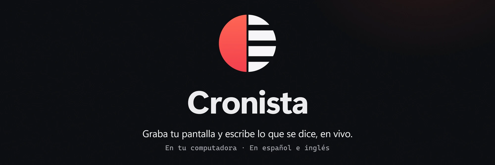
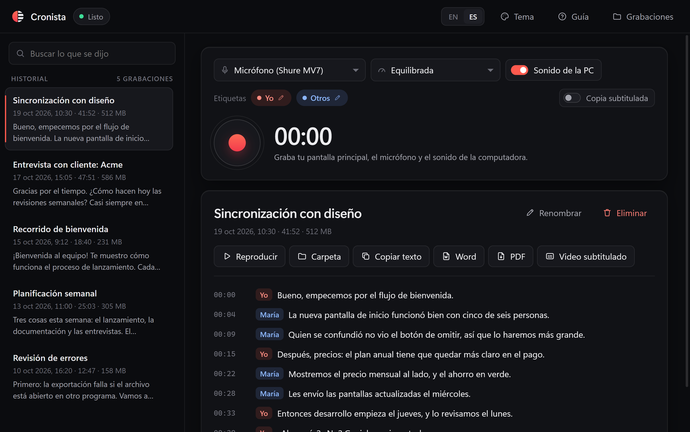

# Cronista

**Graba tu pantalla y escribe lo que se dice, en vivo.**

Cronista graba tu pantalla principal, tu micrófono y el sonido de tu computadora, y escribe lo que se dice mientras hablas, en español o en inglés, distinguiéndote de quienes están en la llamada. Al detener, una pasada final sobre toda la grabación escribe la transcripción que se guarda junto al video y, si quieres, una copia del video con subtítulos. Todo ocurre en tu computadora: el modelo de voz corre en ella y nada se envía a ningún lado.

[Read in English](README.md)

<picture>
  <source srcset="docs/tour-es.avif" type="image/avif" />
  
</picture>


## Instalación

Descarga **Cronista-Setup-0.6.0.exe** desde la [página de versiones](https://github.com/ignaciochiappero/cronista/releases/latest) y ejecútalo. Se instala solo para tu usuario, sin permisos de administrador, y agrega un acceso en el menú Inicio. Trae todo lo que necesita: el modelo de voz y FFmpeg.

El instalador todavía no está firmado, así que Windows SmartScreen muestra un aviso: elige **Más información** y después **Ejecutar de todas formas**. [SECURITY.md](SECURITY.md) (en inglés) explica qué graba la app, dónde lo guarda y cómo verificar la descarga.

## Primeros pasos

1. Elige tu micrófono y la calidad del video.
2. Deja activado **Sonido de la PC** para grabar también lo que suena en la computadora: una llamada, un video, música.
3. Si quieres, ponle nombre a cada voz: haz clic en **Yo** u **Otros**, debajo de los controles (por ejemplo, **Ana** para quien está en la llamada).
4. Pulsa el botón rojo y habla. La transcripción aparece mientras hablas, cada línea con quién la dijo.
5. Vuelve a pulsarlo para detener. Unos segundos después, la grabación aparece primera en el historial, con su transcripción final.

La primera vez, una guía corta te muestra la app. El botón **Guía** la vuelve a abrir.

### Qué puedes hacer

| | |
|---|---|
| **Grabar** | Toda tu pantalla principal en su resolución, tu micrófono y el sonido de la computadora, mezclados. Hasta cuatro horas por grabación. |
| **Leer en vivo** | Las palabras aparecen a medida que se dicen. La transcripción que se guarda sale de una pasada final sobre toda la grabación, que es más precisa. |
| **Saber quién habló** | Tu micrófono y el sonido de la computadora se transcriben por separado, así cada línea dice si fuiste tú o la llamada. Ponle nombre a cada uno con un clic en su etiqueta; las etiquetas de una grabación se pueden cambiar después desde su transcripción. |
| **Subtitular** | **Video subtitulado** hace `recording-subtitled.mp4`, con la transcripción y quién dijo cada línea en pantalla. Activa **Copia subtitulada** para que se haga cada vez que termina una grabación. |
| **Encontrar** | Busca en el historial por cualquier cosa que se dijo. Los resultados aparecen mientras escribes. |
| **Renombrar** | Haz clic en el título de una grabación (o en **Renombrar**, o doble clic en el historial). Enter guarda, Esc cancela. |
| **Exportar** | **Word** y **PDF** escriben la transcripción con sus marcas de tiempo y quién habló, junto al video. |
| **Ver** | **Reproducir** abre el video en tu reproductor; **Carpeta** abre su carpeta. |
| **A tu manera** | Español o inglés, con **EN / ES** arriba. Diez temas en **Tema**: Sistema (claro u oscuro, según Windows), Oscuro, Claro, Medianoche, Océano, Bosque, Uva, Atardecer, Papel y Alto contraste. |

Cada grabación tiene su carpeta en `Videos\Cronista`:

| Archivo | Qué es |
|---|---|
| `recording.mp4` | La pantalla y el sonido (H.264 y AAC) |
| `transcript.srt` | La transcripción como subtítulos, con marcas de tiempo |
| `transcript.txt` | La transcripción como texto plano, una frase por línea |
| `transcript.docx`, `transcript.pdf` | Cuando los exportas |
| `recording-subtitled.mp4` | El video con subtítulos, cuando lo haces |
| `recorder.log` | Lo que informó FFmpeg durante la grabación, por si algo falla |

**Sonido de la PC** sigue al dispositivo de reproducción predeterminado de Windows, así que puedes conectar auriculares en medio de una grabación. Con altavoces en lugar de auriculares, el micrófono también capta ese sonido unos 40 ms después, y en el video se oye como un eco; la transcripción deja afuera las líneas en que el micrófono solo repitió la llamada, pero con auriculares las dos fuentes quedan limpias.

### Requisitos

| | |
|---|---|
| Windows 11, 64 bits | Se desarrolló y probó en él. Windows 10 no está probado. |
| Una tarjeta gráfica que codifique H.264 | La pantalla la codifica la tarjeta gráfica, a través de Media Foundation. |
| Alrededor de 1 GB de disco | Para la app, su modelo de voz y FFmpeg. Las grabaciones ocupan más. |

## Cómo está hecha

La descripción técnica completa (las piezas, y cómo se sincronizan el sonido y la imagen) está en el [README en inglés](README.md#how-it-is-put-together).

## Desarrollo

```powershell
uv venv --python 3.11 .venv
uv pip install --python .venv\Scripts\python.exe -r pyproject.toml pytest "onnx-asr[hub]"
.\.venv\Scripts\python.exe app.py
.\.venv\Scripts\python.exe -m pytest -q
```

FFmpeg tiene que estar en el PATH (`winget install ffmpeg`). El modelo de voz va en `models/parakeet-tdt-0.6b-v3`: si esa carpeta todavía no existe, el primer inicio lo descarga ahí (unos 640 MB, los archivos int8 de [istupakov/parakeet-tdt-0.6b-v3-onnx](https://huggingface.co/istupakov/parakeet-tdt-0.6b-v3-onnx)). Después, la app funciona sin conexión.

Para armar el instalador, sigue los pasos de [Build the installer](README.md#build-the-installer).

## Límites

- Solo se graba la pantalla principal, completa: no otro monitor, una ventana o una región.
- Español e inglés son los idiomas para los que está hecha y probada.
- En Linux hay un grabador (solo micrófono) que solo se probó en WSL; en macOS no hay.
- No hay actualización automática: una versión nueva es una descarga nueva.

## Licencia

Cronista es de código abierto, bajo la [Licencia Apache 2.0](LICENSE). Copyright 2026 Nacho Chiappero. Ver [NOTICE](NOTICE).

El instalador también incluye FFmpeg (LGPL v3), el modelo de voz Parakeet TDT de NVIDIA (CC BY 4.0) y Python con los paquetes que lista [THIRD-PARTY-NOTICES.md](THIRD-PARTY-NOTICES.md), cada uno con su propia licencia.
