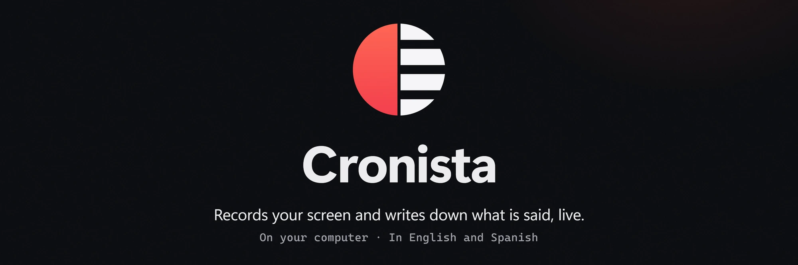
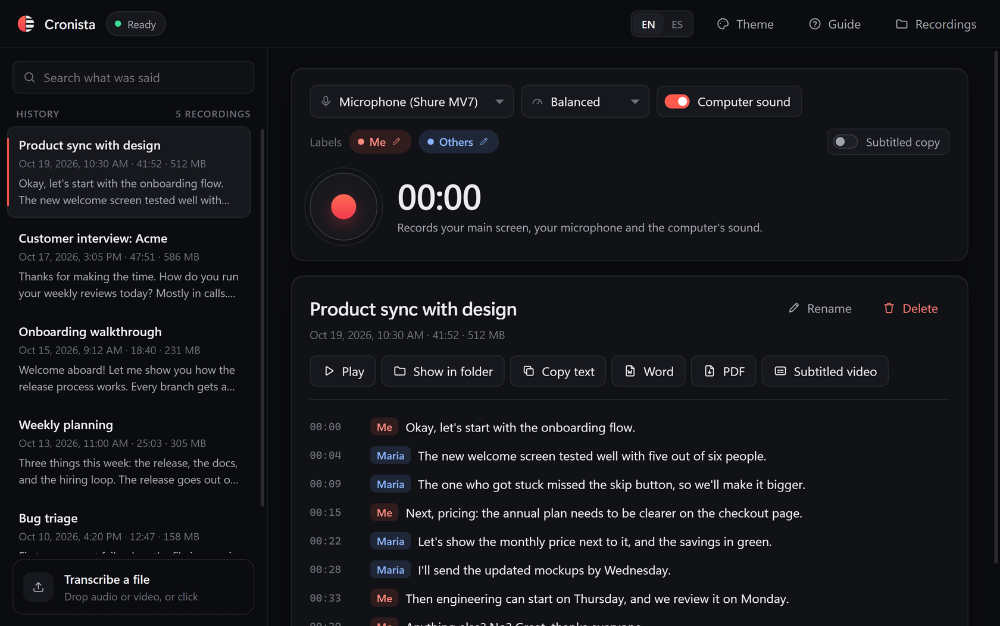

# Cronista

**Records your screen and writes down what is said, live.**

Cronista records your main screen, your microphone and the sound of your computer, and writes down what is said while you speak, in English or Spanish, telling you apart from the people on the call. When you stop, a final pass over the whole recording writes the transcript that is saved next to the video, and, if you want, a copy of the video with subtitles. Drop an audio or video file on it, in any format, and it writes that file's transcript too. It all happens on your computer: the speech model runs on it, and nothing is sent anywhere.

[Leer en español](README.es.md)

<picture>
  <source srcset="docs/tour.avif" type="image/avif" />
  
</picture>


## Install

Download **Cronista-Setup-0.7.1.exe** from the [Releases page](https://github.com/ignaciochiappero/cronista/releases/latest) and run it. It installs for your user only, without administrator rights, and adds a Start menu shortcut. Everything it needs comes inside: the speech model and FFmpeg.

The installer is not code-signed yet, so Windows SmartScreen warns about it: choose **More info**, then **Run anyway**. [SECURITY.md](SECURITY.md) says what the app records, where it keeps it, and how to check your download.

## First steps

1. Pick your microphone and the video quality.
2. Leave **Computer sound** on to also record what plays on the computer: a call, a video, music.
3. Name the voices if you like: click **Me** or **Others** under the controls (say, **Ana** for the person on the call).
4. Press the red button and talk. The transcript appears as you speak, each line with who said it.
5. Press it again to stop. A few seconds later the recording is first in the history, with its final transcript.

The first time, a short guide shows you around. **Guide** brings it back.

### What you can do

| | |
|---|---|
| **Record** | Your whole main screen at its own resolution, your microphone, and the computer's sound, mixed together. Up to four hours per recording. |
| **Read it live** | The words show up as they are said. The saved transcript comes from a final pass over the whole recording, which is more accurate. |
| **Transcribe a file** | Drop audio or video anywhere on the window, in any format FFmpeg reads (MP3, WAV, M4A, OGG, FLAC, MP4, MKV, MOV, WebM and more), or click **Transcribe a file**. Its transcript shows up as it is written, and it joins the history like a recording; files dropped together wait their turn. The file is not copied: **Play** and **Show in folder** open it where it is, and **Delete** removes only its transcript. |
| **Know who said it** | Your microphone and the computer's sound are transcribed apart, so every line says whether it was you or the call. Name each with a click on its label; a recording's labels can be renamed later from its transcript. |
| **Subtitle it** | **Subtitled video** makes `recording-subtitled.mp4`, with the transcript and who said each line on screen. While it is made, the button fills up and says how long is left. Turn on **Subtitled copy** to get it every time a recording stops. |
| **Find it** | Search the history by anything that was said. Results come as you type. |
| **Rename it** | Click a recording's title (or **Rename**, or double-click it in the history). Enter saves, Esc cancels. |
| **Export it** | **Word** and **PDF** write the transcript with its timestamps and who spoke, next to the video. |
| **Watch it** | **Play** opens the video in your usual player; **Show in folder** opens its folder. |
| **Your way** | English or Spanish, with **EN / ES** at the top. Ten themes in **Theme**: System (light or dark, as Windows is), Dark, Light, Midnight, Ocean, Forest, Grape, Sunset, Paper and High contrast. |

Each recording has its own folder in `Videos\Cronista`:

| File | What it is |
|---|---|
| `recording.mp4` | The screen and the sound (H.264 and AAC) |
| `transcript.srt` | The transcript as subtitles, with timestamps |
| `transcript.txt` | The transcript as plain text, one phrase per line |
| `transcript.docx`, `transcript.pdf` | Once you export them |
| `recording-subtitled.mp4` | The video with subtitles, once you make it |
| `recorder.log` | What FFmpeg reported while recording, for when something goes wrong |

A transcribed file gets a folder there too, with its `transcript.srt` and `transcript.txt`, and its Word, PDF or subtitled copy (`<file name>-subtitled.mp4`) once you make them. The file itself stays where it was.

**Computer sound** follows Windows' default playback device, so plugging in headphones mid-recording is fine. With speakers instead of headphones, the microphone also picks up that sound about 40 ms later, which sounds like an echo in the video; the transcript leaves out the lines where the microphone only repeated the call, but headphones keep both clean.

### Requirements

| | |
|---|---|
| Windows 11, 64-bit | Developed and tested on it. Windows 10 is untested. |
| A graphics card that encodes H.264 | The screen is encoded by the graphics card, through Media Foundation. |
| About 1 GB of disk | For the app, its speech model and FFmpeg. Recordings take more. |

## How it is put together

| Piece | What it does | Comes from |
|---|---|---|
| `cronista/engine/recorders.py` | Two FFmpeg processes: the screen (Windows.Graphics.Capture, hardware H.264 through Media Foundation) and the audio (the microphone and the computer's sound, mixed for the file and side by side as two channels for the model); put together in `recording.mp4` when it stops | the recorder spike |
| `cronista/engine/audio_sources.py`, `wasapi.py` | The microphone and the computer's sound (loopback of the default playback device) through WASAPI, kept gapless on the QPC clock and handed to FFmpeg through named pipes (FFmpeg has no WASAPI input) | new; COM interfaces from pycaw |
| `cronista/engine/session.py` | One recording: the processes, the audio's start at the screen's first frame, live transcription of each source while it runs, the final pass when it stops | the spike's `spike.py` |
| `cronista/engine/voices.py` | Who said it: each phrase's source, the labels, and the microphone's echoes of the computer, left out | new |
| `cronista/engine/voice_activity.py`, `local_agreement.py` | Phrase detection and steady live text | bavel |
| `cronista/engine/final_pass.py` | The saved transcript, in pause-aligned chunks of about 90 s, skipping the silent ones | the spike, plus chunking |
| `cronista/importer.py` | A dropped file: what FFmpeg reports on it (length, sound, pictures), its first audio stream decoded to 16 kHz, and the final pass over it in 30 s chunks whose lines are shown as they come | new; the drop, as in escriba's launcher |
| `cronista/library.py` | History with full-text search (SQLite FTS5) | escriba's `database.py` |
| `cronista/export.py`, `language.py` | SRT, plain text, Word, and PDF (reportlab, with Segoe UI embedded), headed in the page's language, with who said what | escriba's `document.py`, plus the PDF |
| `cronista/subtitles.py` | The subtitled copy: the transcript as ASS, drawn by FFmpeg's libass and re-encoded on the graphics card | new |
| `cronista/app_api.py`, `app.py`, `ui/index.html` | The window (pywebview) and its page, with the guide and both languages | escriba's launcher |
| `cronista/linux/portal_recorder.py` | Linux recorder through the desktop portal and GStreamer | tested in WSL only |

### Sound and picture together

Everything is timed on one clock, QPC: Windows stamps the screen's frames and every WASAPI audio packet with it. FFmpeg logs the screen's first frame (showinfo), and both audio streams start at the moment that line arrives, so sound and picture share their time zero; each packet then goes where its stamp says. Measured with a box flashing on screen while a beep played, the computer's sound sat within about 15 ms of the picture in 7 of 8 runs (the first run measured was 40-80 ms off). The same beep reached the microphone 40 ms after the loopback copy, every time: the speaker's, the air's and the microphone's own delay.

The screen and the audio are separate FFmpeg processes because in one, a still screen held the audio back: FFmpeg paces its inputs to the stream that lags most, and the screen capture sends frames only when something changes (20 s of still screen let 1 s of audio through). For the same reason, a still screen made FFmpeg ignore "q": the session shows a one-pixel window for a moment when it stops, which also gives the video a last frame at the end.

## Development

```powershell
uv venv --python 3.11 .venv
uv pip install --python .venv\Scripts\python.exe -r pyproject.toml pytest "onnx-asr[hub]"
.\.venv\Scripts\python.exe app.py
.\.venv\Scripts\python.exe -m pytest -q
```

FFmpeg must be on PATH (`winget install ffmpeg`). The speech model lives in `models/parakeet-tdt-0.6b-v3`: when that folder does not exist yet, the first start downloads it there (about 640 MB, the int8 files of [istupakov/parakeet-tdt-0.6b-v3-onnx](https://huggingface.co/istupakov/parakeet-tdt-0.6b-v3-onnx)). After that the app works offline.

### Build the installer

```powershell
.\.venv\Scripts\python.exe tools\make_icon.py                 # only if the logo changed
$env:FFMPEG_EXE = "C:\path\to\ffmpeg-n9.0-latest-win64-lgpl-9.0\bin\ffmpeg.exe"   # an LGPL build, see below
.\.venv\Scripts\pyinstaller.exe cronista.spec --noconfirm --clean
.\dist\Cronista\Cronista.exe --self-test                      # records 5 s with computer sound, transcribes it as a dropped file, checks, deletes; exit code 0 = fine
& "$env:LOCALAPPDATA\Programs\Inno Setup 6\ISCC.exe" installer\cronista.iss
```

PyInstaller puts the app, Python, the model and FFmpeg in `dist\Cronista` (about 890 MB); Inno Setup packs that into `dist\Cronista-Setup-<version>.exe`. The installer installs to `%LOCALAPPDATA%\Programs\Cronista` and adds an uninstaller that keeps the recordings and the history. The packaged app writes its output and errors to `%LOCALAPPDATA%\Cronista\cronista.log`.

The bundled FFmpeg must be an LGPL build. The spec takes the `ffmpeg.exe` that `FFMPEG_EXE` points to (else the one on PATH), stops if it was configured with `--enable-gpl` or `--enable-nonfree`, and puts the build's `LICENSE.txt` next to it, with its version and configuration in `BUILD.txt`. The installer uses BtbN's static LGPL build of FFmpeg 9.0 (`ffmpeg-n9.0-latest-win64-lgpl-9.0.zip` on the [BtbN/FFmpeg-Builds releases](https://github.com/BtbN/FFmpeg-Builds/releases), unzipped outside the repo). [THIRD-PARTY-NOTICES.md](THIRD-PARTY-NOTICES.md) names the exact build and where its source is, so update it when the build changes.

## Limits

- Only the main screen is recorded, all of it: not another monitor, a single window or a region.
- Spanish and English are the languages it is made and tested for.
- Linux has a recorder (microphone only) that has only been tried in WSL; macOS has none.
- There is no automatic update: a new version is a new download.

## License

Cronista is open source under the [Apache License 2.0](LICENSE). Copyright 2026 Nacho Chiappero. See [NOTICE](NOTICE).

The installer also contains FFmpeg (LGPL v3), the Parakeet TDT speech model by NVIDIA (CC BY 4.0), and Python with the packages listed in [THIRD-PARTY-NOTICES.md](THIRD-PARTY-NOTICES.md), each under its own license.
